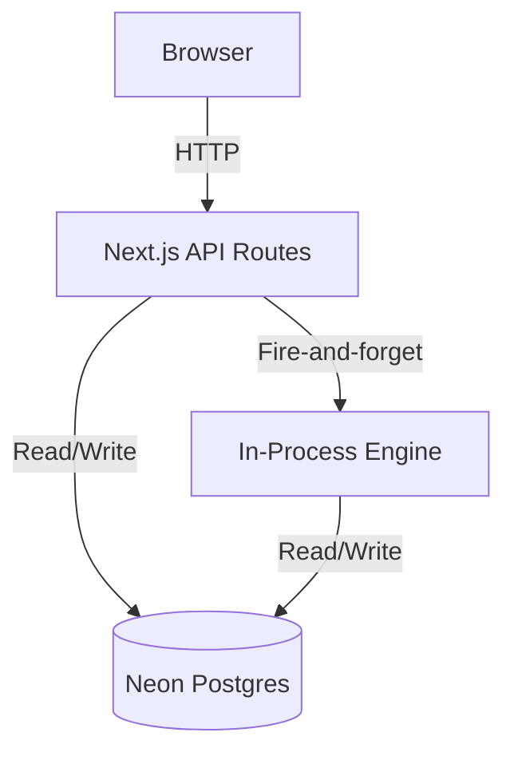

# Flowforge

**An event-driven AI workflow orchestration platform.**

Flowforge is a distributed workflow orchestration system designed to execute, coordinate, and monitor AI-powered workflows.

The project explores how to build reliable distributed systems using event-driven architecture, asynchronous job processing, and independently deployable services.

> **Project status:** Early development. Core infrastructure and architecture are being established.

## Goals

- Build an event-driven workflow execution engine.
- Support asynchronous and distributed workflow execution.
- Coordinate workers through durable event messaging.
- Provide reliable execution, retries, and failure handling.
- Track workflow state and execution history.
- Expose workflow management through a web dashboard.
- Support observability across distributed services.

## Architecture

Flowforge is organized as a pnpm and Turborepo monorepo.

### Current Architecture (Phase 1 Baseline)

In Phase 1, the system runs as a monolith. The web server both handles API requests and executes workflows in-process. This is documented as a known limitation.

