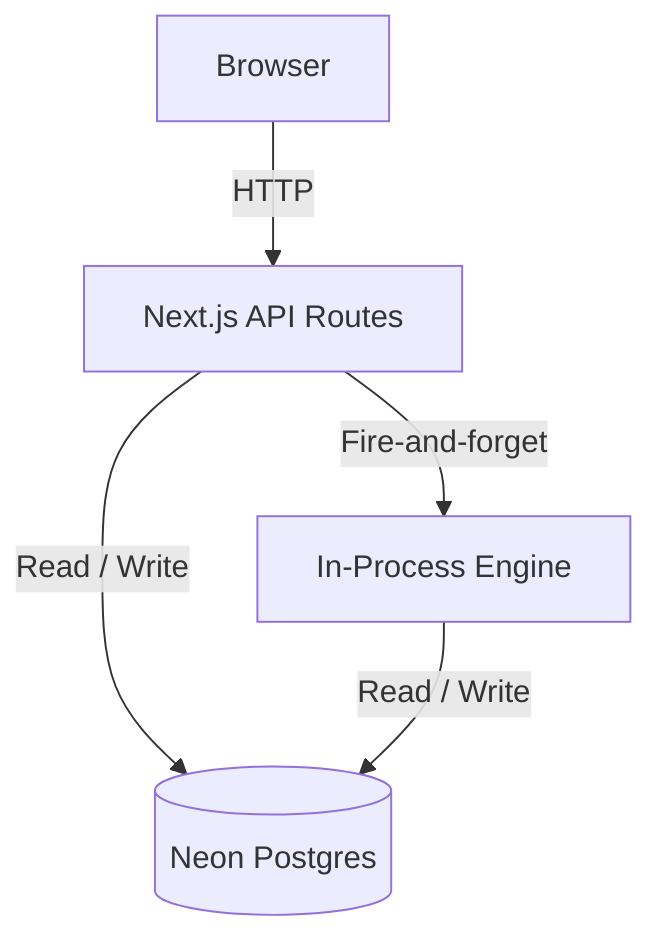
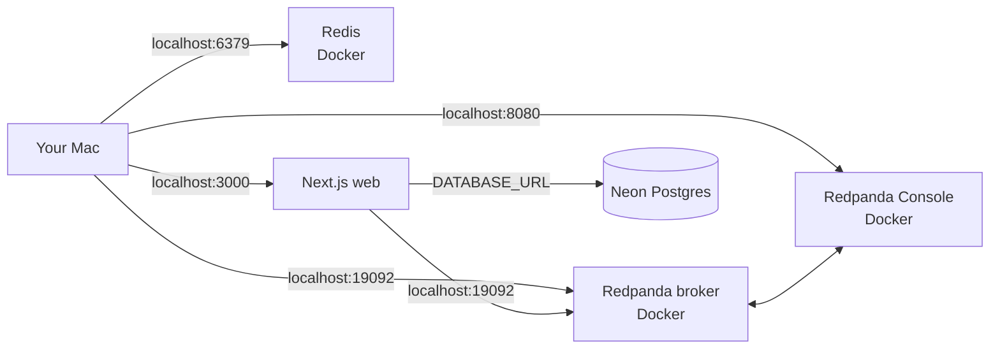

# FlowForge

**An event-driven AI workflow orchestration platform.**

FlowForge is a distributed workflow orchestration system designed to execute, coordinate, and monitor AI-powered workflows.

The project explores how to build reliable distributed systems using event-driven architecture, asynchronous job processing, and independently deployable services.

> **Project status:** Early development. Phase 1 (monolith baseline) is complete, and Phase 2 (local infrastructure and Kafka fundamentals) is complete.

---

## Goals

- Build an event-driven workflow execution engine.
- Support asynchronous and distributed workflow execution.
- Coordinate workers through durable event messaging.
- Provide reliable execution, retries, and failure handling.
- Track workflow state and execution history.
- Expose workflow management through a web dashboard.
- Support observability across distributed services.

---

## Architecture

FlowForge is organized as a pnpm and Turborepo monorepo.

### Current Architecture

#### Phase 1: Monolith Baseline

In Phase 1, the system runs as a monolith. The web server handles API requests and executes workflows in-process.

This architecture establishes the initial application baseline but has limitations around independent scaling, fault isolation, and distributed execution.



#### Phase 2: Local Infrastructure

Phase 2 introduces the local infrastructure required for the transition toward event-driven architecture.

The Docker Compose stack includes:

- **Redpanda:** Kafka-compatible event broker for durable event messaging.
- **Redpanda Console:** Web interface for inspecting topics, partitions, consumer groups, and messages.
- **Redis:** In-memory data store for future caching and coordination requirements.

The infrastructure runs locally through Docker Compose.



**Kafka networking:**

The web application currently runs directly on the host machine, so it connects to Redpanda through the external Kafka listener:

```env
KAFKA_BROKERS=localhost:19092
```

If the web application is containerized in a future phase, switch to the internal Docker listener:

```env
KAFKA_BROKERS=redpanda:9092
```

The `redpanda` hostname is only resolvable inside the Docker network.

**Important:** Phase 2 establishes the infrastructure and Kafka fundamentals. The actual distributed workflow execution architecture will be introduced in Phase 3.

---

## Getting Started

### Prerequisites

Make sure the following tools are installed:

- Node.js 22+ (Node.js 25 is not supported by the Kafka native bindings).
- pnpm 10+.
- Docker Desktop (for Redpanda and Redis).
- Git.

### Installation

Clone the repository:

```bash
git clone <your-repository-url>
cd flowforge
```

Install dependencies:

```bash
pnpm install
```

Create your local environment file:

```bash
cp .env.example .env
```

Update `.env` with your Neon connection string.

The Kafka and Redis configuration values are already populated for the local Docker infrastructure.

### Start Local Infrastructure

Start the infrastructure:

```bash
pnpm dev:infra
```

This starts:

- Redpanda
- Redpanda Console
- Redis

All services run in Docker in the background.

Open Redpanda Console:

http://localhost:8080

### Run the Dashboard

Open a second terminal from the repository root.

Start the Next.js web application:

```bash
pnpm --filter @flowforge/web dev
```

Open the dashboard:

http://localhost:3000

### Verify the Stack

Check that the infrastructure containers are running:

```bash
pnpm infra:ps
```

Check that the workflow API is responding:

```bash
curl -s http://localhost:3000/api/workflows | jq
```

### Run Tests

```bash
pnpm test
```

### Lint and Typecheck

Run linting:

```bash
pnpm lint
```

Run TypeScript checks:

```bash
pnpm typecheck
```

### Reset Local Infrastructure

To stop the infrastructure and remove its persistent Docker volumes:

```bash
pnpm infra:reset
```

**Warning:** This permanently deletes locally persisted Kafka and Redis data, including topics, messages, and other data stored in the associated volumes.

To start with a fresh environment afterward:

```bash
pnpm dev:infra
```

---

## Development Roadmap

FlowForge is being developed incrementally, with each phase introducing a new architectural capability.

- [x] Phase 0: Monorepo foundation and developer tooling.
- [x] Phase 1: Domain model, database schema, and monolith baseline.
- [x] Phase 2: Local infrastructure (Redpanda, Redis) and Kafka fundamentals.
- [ ] Phase 3: Event-driven architecture (Kafka / Redpanda).

Future phases will build on the distributed architecture established in Phase 3.

---

## Documentation

Detailed documentation is maintained in the `docs/` directory.

| Document                       | Description                                           |
| ------------------------------ | ----------------------------------------------------- |
| `docs/domain.md`               | Domain model and glossary                             |
| `docs/api.md`                  | HTTP API reference                                    |
| `docs/baseline.md`             | Phase 1 monolith baseline measurements                |
| `docs/kafka-lab-notes.md`      | Kafka hands-on experiments and observations (Phase 2) |
| `docs/kafka-primer.md`         | Kafka concepts and architecture primer (Phase 2)      |
| `docs/architecture/phase-1.md` | Phase 1 component diagram                             |
| `docs/adr/`                    | Architecture Decision Records                         |

For local infrastructure setup, commands, networking, and troubleshooting, see:

`infra/docker/README.md`

---

## Technology Stack

| Technology       | Purpose                                |
| ---------------- | -------------------------------------- |
| Next.js          | Web application and API                |
| TypeScript       | Application development                |
| pnpm             | Package management                     |
| Turborepo        | Monorepo build orchestration           |
| Neon Postgres    | Hosted relational database             |
| Redpanda         | Kafka-compatible event streaming       |
| Redpanda Console | Event broker monitoring and management |
| Redis            | Caching and coordination               |
| Docker Compose   | Local infrastructure management        |

---

## Project Philosophy

FlowForge is being developed with a focus on understanding and implementing distributed systems fundamentals rather than introducing infrastructure complexity prematurely.

The architecture evolves incrementally:

1. Establish a working monolithic baseline.
2. Introduce local infrastructure and understand event streaming.
3. Move workflow execution toward distributed, event-driven processing.
4. Introduce independent workers and reliable execution mechanisms.
5. Expand toward orchestration, scaling, and observability.

Each phase builds on the previous one, with architectural decisions informed by practical experiments and measurable requirements.
